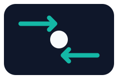

<div align="center">


[](LICENSE)




**An interactive local lab for understanding HTTP Accept headers and media-type selection.**

</div>

## ✨ Overview

Explore how a server chooses among available representations using media ranges, quality values, and specificity.

## 🚀 Features

- 🧭 Parses Accept media ranges and q values.
- 🎯 Applies the most-specific matching range to each offer.
- 📊 Ranks server representations and shows the selected type.
- 🔒 Runs locally with Node.js built-ins and no external dependencies.

## 🧪 Demo

```text
Accept: application/json, text/html;q=0.8
Offers: text/html, application/json
Selected: application/json
```

## ⚡ Quick Start

```bash
git clone https://github.com/CyberLoop-dev/http-content-negotiation-lab.git
cd http-content-negotiation-lab
npm start
```

Open http://127.0.0.1:4173.

## 🧰 Tech Stack

Node.js 20+ · Built-in HTTP server · Browser JavaScript · node:test.

## 🗂️ Folder Structure

```text
http-content-negotiation-lab/
├── server.js
├── package.json
├── public/
│   ├── index.html
│   └── app.js
├── tests/server.test.js
├── .github/workflows/tests.yml
└── assets/mark.svg
```

## 🗺️ Roadmap

- [x] Quality-value and specificity matching
- [x] Local interactive UI and tests
- [ ] Language and encoding negotiation examples
- [ ] Additional Accept parameter handling

## 🤝 Contributing

Add standards-based examples and tests. Keep the local server dependency-free and avoid sending input to remote services.

## 📄 License

MIT — see [LICENSE](LICENSE).

<div align="center"></div>
